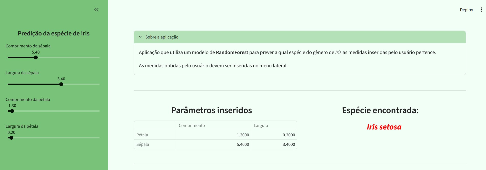
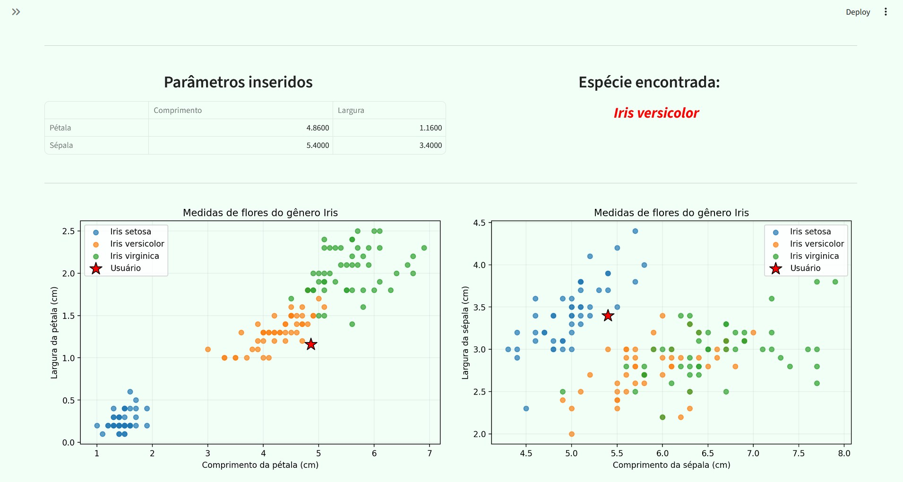

# Iris species prediction

## Description

This project is an interactive dashboard with Streamlit for Iris species prediction based on petal and sepal measures using a Random Forest Classifier. The dashboard allows the user to insert their measurements and returns the most probable species to have that morphology.

## Objectives

- Fit a Random Forest Classifier for species prediction
- Develop an interactive dashboard using Streamlit
- Practive dashboard architecture, input fields, and Machine Learning process

## Dataset

- Iris dataset from scikit-learn library
- It contains petal and sepal width and length from Iris species
- Each observation represents one plant

## Features
### Side Bar

This area offers four input sliders, each one corresponding to one flower measure.

### Main Area

This area presents an expander section with general information about the project.

Below this, two sections containing information about the data inserted. The top one presents a table with the meansures inserted and the most likely species.

The bottom one presents two graphs containing the data used in training and the data inserted by the user.

## Technologies used
- Python
- Streamlit
- scikit-learn
- Jupyter notebook

## Project Structure
project/
    ├── .streamlit/
    |    └── config.toml
    |
    ├── jupyter notebook/
    |    ├── model_prep.ipynb
    |    └── tools.py
    |
    ├── model/
    |    ├── iris_rfc.pkl
    |    ├── ml_model.py
    |    └── model_params.json
    |
    ├── src/
    |    ├── layout.py
    |    └── tools.py
    |
    ├──app.py    
    ├── README.md
    └── requirements.txt

## Screenshots

1. Screenshot presenting the side bar (left) and the main area containing the expander section, a table with the values inserted and the most likely species.

2. Screeshot presenting the dashboard with the side bar closed, the table with the inserted values, the most likely species, and two scatter graphs

## Running the project
### Clone repository

    git clone https://github.com/fabiopalacio/iris_streamlit_dashboard

### Install dependencies

    pip install -r requirements.txt

### Fit RandomForestClassifier

    python ./model/ml_model.py
    
This script:

    - Loads the Iris Dataset
    - Imports model parameters generated from the jupyter notebook model_prep.ipynb (./jupyter notebook/)
    - Fits the machine learning model
    - Saves the model into a file (./model/iris_rfc.pkl) to be used in the dashboard

### New parameters for the model

If needed, it is possible to generate new model parameters. It would allow checking the parameters after new data is inserted into the database. This process is developed in a jupyter notebook file.

#### Run jupyter notebook

    jupyter notebook ./"jupyter notebook"/model_prep.ipynb

This script:
    - Loads the dataset
    - Implements a Cross Validation with Grid Search
    - Selects and saves the best parameters (./model/model_params.json)

### Run the dashboard
    streamlit run app.py         

## Author
- Fabio Palacio

